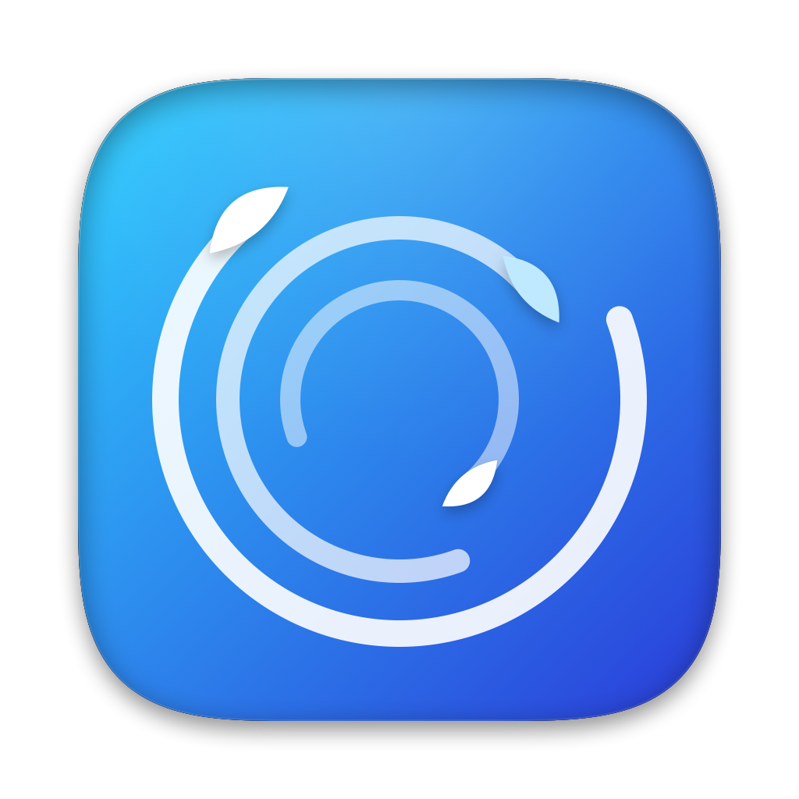

<p align="center">
  
</p>

<h1 align="center">Airy</h1>

<p align="center">
  <b>Entiende y libera el espacio de tu Mac sin miedo a borrar lo que no debes.</b><br>
  Mapa del disco, limpieza segura, rendimiento y un servidor MCP para tus agentes de IA.
</p>

<p align="center">
  <a href="https://github.com/luis-guillen/airy/actions/workflows/ci.yml"></a>
  <a href="https://github.com/luis-guillen/airy/releases/latest"></a>
  
  
  
  <a href="LICENSE"></a>
</p>

<p align="center"><a href="README.md">Read in English</a></p>

---

## Índice

- [Qué es](#qué-es)
- [Funciones](#funciones)
- [Seguridad: cómo decide Airy qué se puede borrar](#seguridad-cómo-decide-airy-qué-se-puede-borrar)
- [Instalación](#instalación)
- [Conectar un agente de IA (MCP)](#conectar-un-agente-de-ia-mcp)
- [Compilar desde el código](#compilar-desde-el-código)
- [Arquitectura](#arquitectura)
- [Pruebas](#pruebas)
- [Publicar una versión](#publicar-una-versión)
- [Privacidad](#privacidad)
- [Contribuir](#contribuir)
- [Créditos](#créditos)
- [Licencia](#licencia)

## Qué es

Airy es una app nativa de macOS, hecha con SwiftUI, que analiza el disco y muestra qué ocupa espacio en
un mapa interactivo. Separa lo que se puede borrar sin problema de lo que conviene revisar y de lo que
nunca se toca. Todo se decide en local, y cada borrado pasa por una confirmación.

También incluye `airy-mcp`, un servidor [MCP](https://modelcontextprotocol.io) por stdio. Con él,
Claude Code, Codex u otros agentes pueden consultar el disco y proponer limpiezas. Los agentes nunca
actúan por su cuenta sobre nada que no sea seguro.

## Funciones

| Sección | Qué hace |
|---|---|
| **Mapa** | Mapa del disco (treemap) con zoom, categorías por color, tamaños reales en disco y análisis incremental guardado en un índice. |
| **Limpieza** | Cachés, registros y artefactos de desarrollo (`node_modules`, DerivedData, Docker…), además de versiones duplicadas de pyenv, conda, rustup y Homebrew. Cada elemento lleva una etiqueta: **Sin problema**, **Tú decides** o **No borrar**. Modos Agresivo y Prudente, selección múltiple y «Borrar todo». |
| **Rendimiento** | Memoria, CPU, temperatura y batería, y las apps que más consumen. Permite cerrar apps con confirmación y aplicar mantenimiento reversible. «¿Por qué va lento?» lo explica con IA, que es opcional. |
| **Asistente IA** | Informe y chat sobre tu disco con Claude. Solo se envían metadatos, nunca el contenido de los archivos. |
| **Desinstalador** | Desinstala apps junto con sus restos: Homebrew, cuando es seguro, y si no, la Papelera. También encuentra restos huérfanos de apps ya borradas y enlaces rotos. |
| **Grandes y viejos** | Archivos grandes que no abres desde hace tiempo, con filtros. |
| **Duplicados** | Copias idénticas, comprobadas byte a byte. La copia que se conserva nunca se marca. |
| **Tipos de archivo** | Espacio ocupado por cada tipo de archivo (vídeo, fotos, código…), con acceso a los archivos. |

Las animaciones de viento se detienen cuando la ventana no se ve, respetan «Reducir movimiento» y van
con la frecuencia de fotogramas limitada. En reposo, Airy no usa CPU.

## Seguridad: cómo decide Airy qué se puede borrar

Airy aplica varias capas de protección, que se ejecutan en este orden. Ninguna capa posterior puede
rebajar el riesgo que ha fijado una anterior:

1. **Protecciones duras.** Hay ubicaciones que nunca se marcan ni se mueven a la Papelera:
   - carpetas personales;
   - del sistema: `/System`, `/Library`, `/usr`, `/Applications`, `/opt/homebrew`;
   - datos personales: iCloud Drive, Mail, Mensajes, Llaveros, Fotos y Contactos;
   - volúmenes de Docker;
   - claves SSH y GPG;
   - datos de los perfiles de navegador: Safari, Chrome, Brave, Firefox, Arc, Opera, Edge, Vivaldi y Chromium;
   - datos de Signal, de los gestores de contraseñas y de las apps sensibles.

   Las cachés de esas apps sí se pueden limpiar, pero solo las rutas exactas que declara el catálogo.
2. **Catálogo cerrado.** Cada elemento que se puede limpiar es una ficha de `catalog.json` con sus rutas,
   su riesgo y su comando oficial, si lo tiene. `CommandPolicy` vuelve a validar cada comando justo antes
   de ejecutarlo. Por ejemplo, prohíbe `docker volume prune`, `--volumes` y `brew --zap`.
3. **En uso.** No se toca nada que esté abierto, que pertenezca a un proceso en marcha o que pida un
   proyecto. Si Airy no puede comprobarlo a tiempo, no lo toca.
4. **Embudo único.** Toda acción destructiva pasa por `ConfirmSheet → AppModel → CleanupExecutor`.
   Cerrar apps sigue un camino propio que también confirma: `QuitExecutor`. Lo que se borra va a la
   Papelera siempre que es posible. Cada operación queda registrada.
5. **Agentes con límites.**
   - Por MCP solo se puede ejecutar lo que está en verde en el modo actual.
   - Lo ámbar y lo rojo solo se pueden *proponer*, nunca ejecutar.
   - Los agentes nunca cierran apps, nunca desinstalan y nunca vacían la Papelera.
   - Si el interruptor de agentes está apagado, o la configuración no se puede leer, se bloquean todas
     las acciones, incluido `dry_run`.

## Instalación

### Desde una release

1. Descarga `Airy-<versión>.zip` de [Releases](https://github.com/luis-guillen/airy/releases) y descomprímelo.
2. Mueve **Airy.app** a `/Aplicaciones`.
3. La app está firmada con una identidad local y no está notarizada. La primera vez, haz clic derecho
   → **Abrir** o ejecuta:
   ```bash
   xattr -dr com.apple.quarantine /Applications/Airy.app
   ```
4. Ve a **Ajustes del Sistema → Privacidad y seguridad → Acceso total al disco** y activa Airy. Sin ese
   permiso, el análisis será parcial.

Requisitos: macOS 15 o posterior y Apple Silicon. Las releases son `arm64`; en Intel, compílala desde
el código.

## Conectar un agente de IA (MCP)

El servidor va dentro de la app, en `Airy.app/Contents/MacOS/airy-mcp`. La sección **Asistente IA →
Conectar agente** genera la configuración y puede exportarla. A mano:

```bash
# Claude Code
claude mcp add -s user airy -- /Applications/Airy.app/Contents/MacOS/airy-mcp
```

```json
{
  "mcpServers": {
    "airy": { "command": "/Applications/Airy.app/Contents/MacOS/airy-mcp", "args": [] }
  }
}
```

Herramientas disponibles:

- **Consulta:** `get_disk_summary`, `list_largest`, `explain_path`, `list_cleanup_items`,
  `get_performance`, `list_apps`, `explain_app`, `list_orphans`, `list_large_old`, `list_duplicates`,
  `scan_status`.
- **Acción:** `run_safe_cleanup`, `run_safe_cleanup_all` (solo lo verde y con `dry_run`), `propose_cleanup`,
  `propose_quit_app`, `propose_uninstall`, `show_in_app`.

Las propuestas abren Airy con una URL `airy://…`. Siempre decides tú.

## Compilar desde el código

Basta con las Command Line Tools de Xcode. Xcode completo no es necesario.

```bash
git clone https://github.com/luis-guillen/airy.git && cd airy
swift build                       # depuración
swift test --no-parallel          # ~950 pruebas
bash scripts/build-app.sh         # build/Airy.app firmada
bash scripts/build-app.sh --install   # y la instala en /Applications
```

`build-app.sh` crea una única vez la identidad de firma local **«Airy Local Signing»** en el llavero de
inicio de sesión. Así macOS mantiene el permiso de Acceso total al disco entre compilaciones.

Variables solo para DEBUG, útiles para desarrollar sin tocar el disco real:

| Variable | Efecto |
|---|---|
| `AIRY_SUPPORT_DIR` | Carpeta de datos alternativa: índice, ajustes y registro. |
| `AIRY_SCAN_ROOTS` | Analiza solo estas carpetas, separadas por `:`. |
| `AIRY_APP_ROOTS` | Carpetas de apps falsas para el Desinstalador. |
| `AIRY_REDUCE_MOTION` | Fuerza «Reducir movimiento». |
| `AIRY_MOTION_GALLERY` | Galería de animaciones. |

## Arquitectura

```
Sources/
├── DiskMapCore/      Lógica sin interfaz (se prueba aquí)
│   ├── Scan/         Escáner concurrente con límite de hilos e índice incremental
│   ├── Catalog/      Catálogo de limpieza (Resources/catalog.json)
│   ├── Cleanup/      Detección, CleanupExecutor y fuentes (toolchains, Docker, cachés de apps…)
│   ├── Safety/       HardProtections, CommandPolicy, ProcessGuard, presupuestos de tiempo
│   ├── Performance/  Sondas de procesos, memoria, temperatura y batería
│   ├── Apps/         Inventario de apps, Homebrew, recibos y restos huérfanos
│   ├── Sections/     Grandes y viejos, duplicados y tipos de archivo
│   ├── AI/           Llamada cerrada a Claude CLI, solo con metadatos
│   └── MCP/          Protocolo y herramientas del servidor
├── Airy/             App SwiftUI (secciones, diseño y animaciones)
└── AiryMCP/          Ejecutable airy-mcp (stdio)
Tests/DiskMapCoreTests/   Swift Testing
docs/superpowers/         Especificaciones y planes de diseño
```

## Pruebas

```bash
swift test --no-parallel
```

Las pruebas usan carpetas temporales y procesos falsos. Nunca borran archivos reales ni ejecutan
limpiezas de verdad. Algunas miden tiempos, así que conviene ejecutarlas en serie (`--no-parallel`)
para que no fallen cuando la máquina va cargada.

## Publicar una versión

```bash
bash scripts/release.sh 0.2.0
```

El script:

1. sube la versión en `Info.plist`;
2. pasa las pruebas;
3. compila y firma;
4. empaqueta `Airy-<versión>.zip` con su `SHA256`;
5. crea la etiqueta `v<versión>` y la release en GitHub con las notas del `CHANGELOG.md`.

## Privacidad

- Airy no tiene telemetría y no se conecta a ningún servidor propio.
- La IA es opcional. Usa tu Claude CLI con herramientas desactivadas, sin MCP y sin guardar sesión, y
  solo recibe metadatos: rutas, tamaños y nombres de procesos. Nunca recibe el contenido de los archivos.

## Contribuir

Los issues y pull requests son bienvenidos, en español o en inglés. Lee [CONTRIBUTING.md](CONTRIBUTING.md) y el
[Código de conducta](CODE_OF_CONDUCT.md).

## Créditos

Airy adapta ideas y listas de rutas de [Mole](https://github.com/tw93/Mole) (GPL-3.0), sin incluir su
código. El crédito aparece también en **Acerca de Airy**.

## Licencia

[GPL-3.0 o posterior](LICENSE) © 2026 Luis Guillén y colaboradores de Airy.
